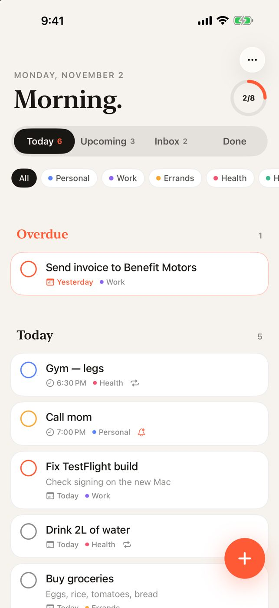
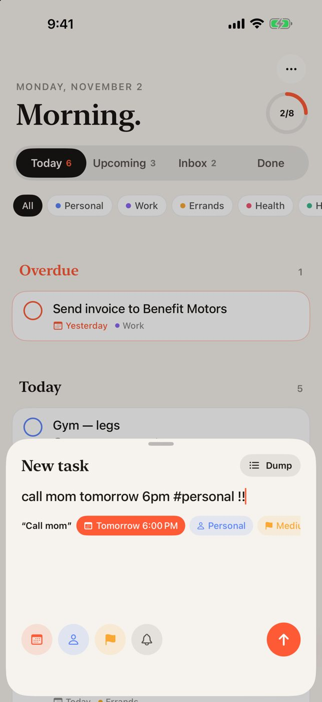
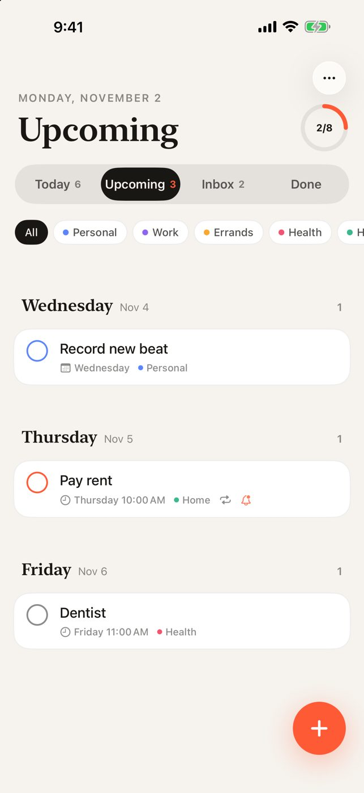
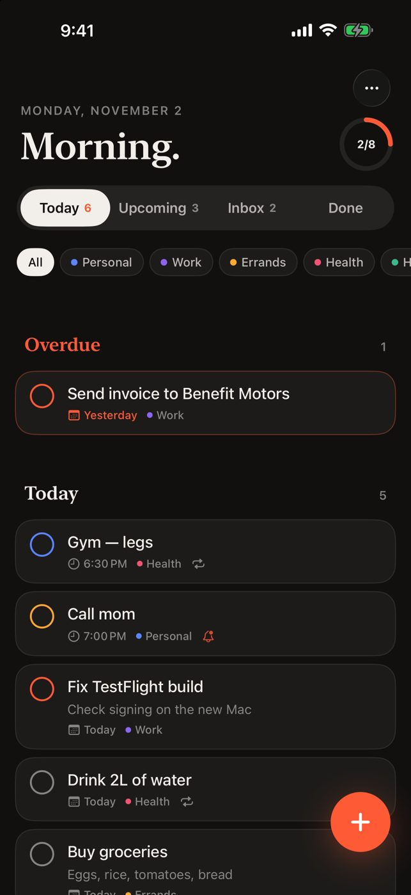
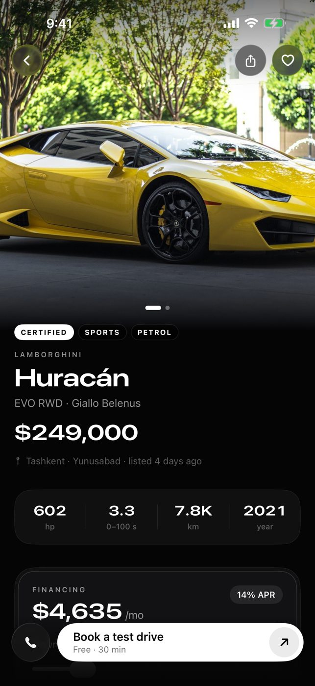
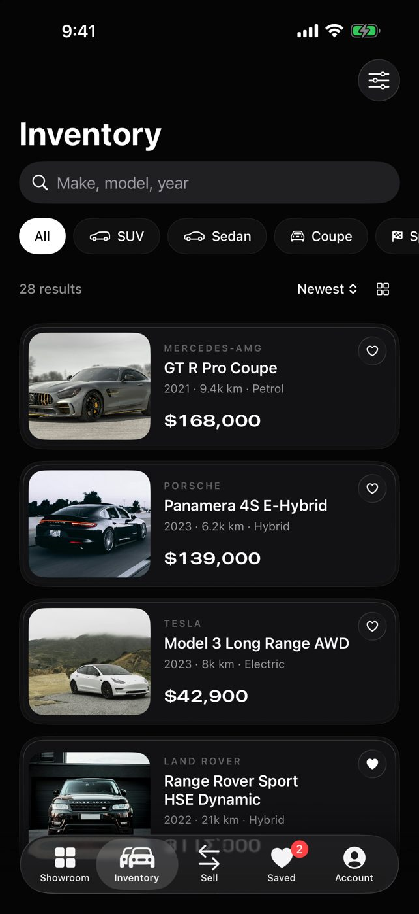
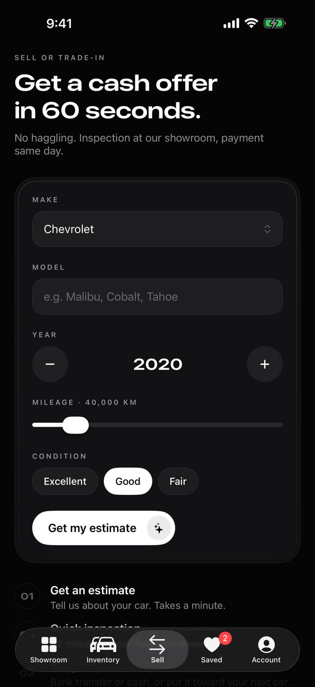

# Plagueson Apps

Little demo apps I make in my free time. Install them with **SideStore** using your own Apple ID.

**Source URL:** `https://azamoviich.github.io/plagueson-apps/apps.json` · **Page:** https://azamoviich.github.io/plagueson-apps

## Nudge — a to-do app for people who forget
Natural-language quick add, brain dump, nag reminders, morning digest.

   

## Benefit Motors — demo car dealership
Inventory, financing calculator, test-drive booking, trade-in estimate. Not a real store; cars and prices are made up.

   

---

## Install with SideStore

SideStore installs apps outside the App Store using **your own free Apple ID**, and refreshes them **on your iPhone** — no computer needed after setup.

## One-time setup (≈15 min, needs a computer once)

1. Follow the official install guide: **https://docs.sidestore.io** → *Installation*.
   It walks you through installing SideStore and creating your pairing file.
2. On the iPhone: **Settings → Privacy & Security → Developer Mode → On** (phone restarts).
3. **Settings → General → VPN & Device Management** → trust your Apple ID.
4. Open SideStore and sign in with your Apple ID (a spare Apple ID is fine).

## Add my apps

1. SideStore → **Sources** → **+**
2. Paste: `https://azamoviich.github.io/plagueson-apps/apps.json`
3. Tap **Nudge** or **Benefit Motors** → **Free / Install**.

## Keeping apps alive

- Apps signed with a free Apple ID last **7 days**.
- Open SideStore every few days and tap **Refresh All** (keep its connection/VPN app on, per the SideStore guide).
- If an app expires, nothing is lost — just refresh and it opens again with your data.

## Limits of a free Apple ID

- Max **3 sideloaded apps at once** (SideStore counts as one → room for 2 more).
- Max **10 new App IDs per 7 days**. If you see that error, wait for the week to roll over.
- Requires **iOS 26** or newer.
