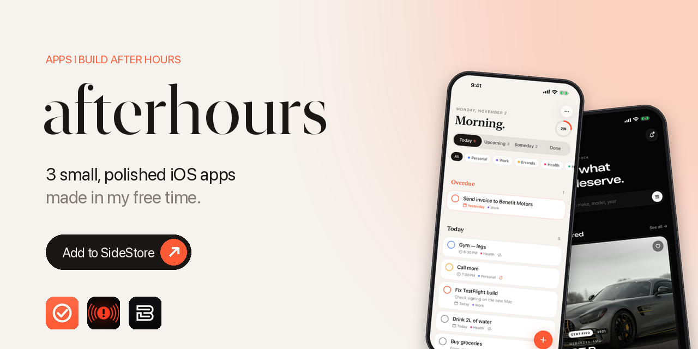
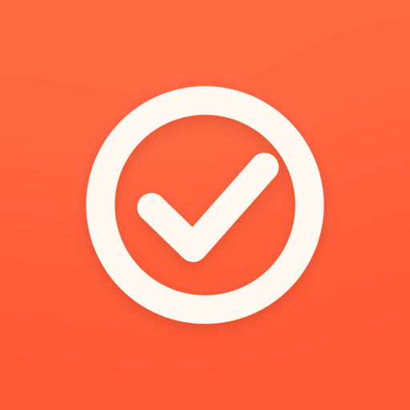
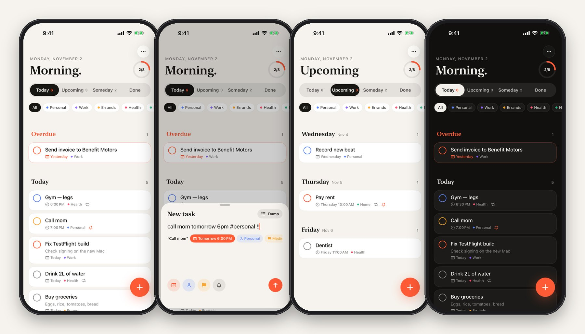
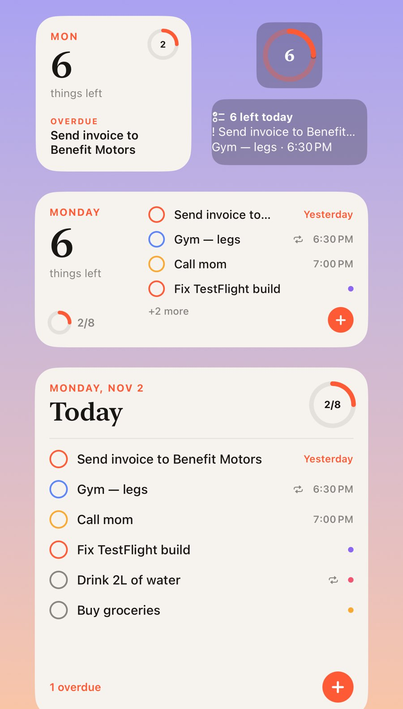
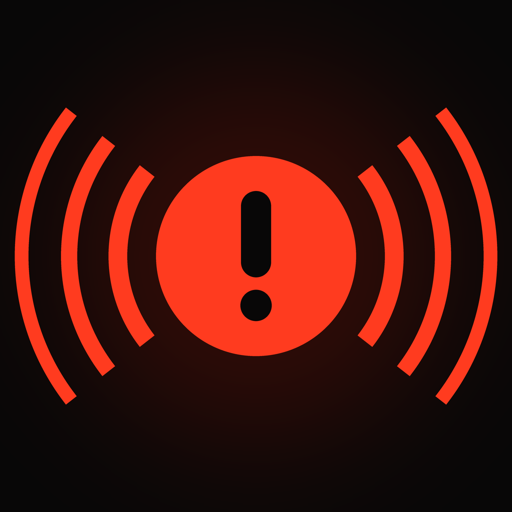
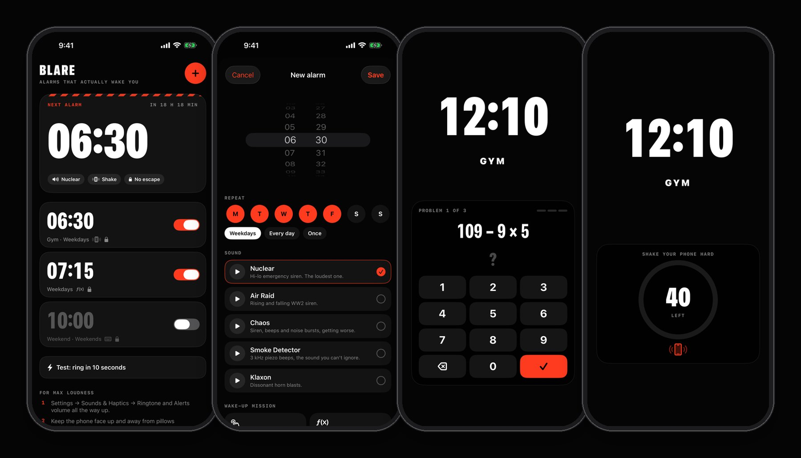
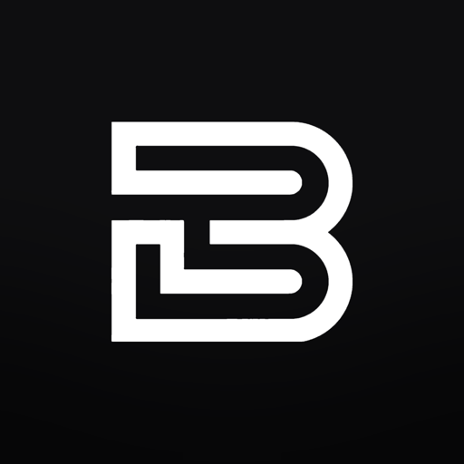
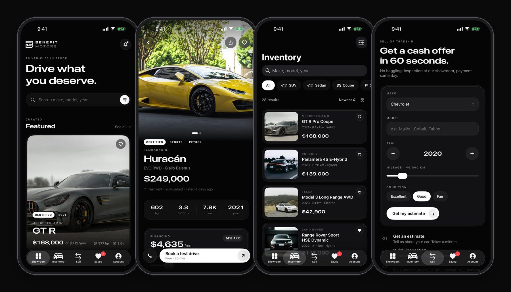

<p align="center">
  
</p>

<p align="center">
  <a href="https://azamoviich.github.io/afterhours"><b>Website</b></a> ·
  <a href="#install">Install</a> ·
  <a href="#nudge">Nudge</a> ·
  <a href="#blare">Blare</a> ·
  <a href="#benefit-motors">Benefit Motors</a> ·
  <a href="#faq">FAQ</a>
</p>

<p align="center">
  
  
  
  
</p>

---

Little iOS apps I make in my free time. Native SwiftUI, no accounts, no tracking, nothing to buy. They're demos and experiments, not companies, so expect rough edges and frequent updates.

## Install

**Add this source to SideStore:**

```
https://azamoviich.github.io/afterhours/apps.json
```

Or open **[azamoviich.github.io/afterhours](https://azamoviich.github.io/afterhours)** on your iPhone and tap **Add to SideStore**.

<details>
<summary><b>First time using SideStore?</b> (about 15 minutes, needs a computer once)</summary>

<br>

1. Follow the official guide at **[docs.sidestore.io](https://docs.sidestore.io)** to install SideStore and create your pairing file.
2. On your iPhone: **Settings → Privacy & Security → Developer Mode → On**. The phone restarts.
3. **Settings → General → VPN & Device Management** → trust your Apple ID.
4. Open SideStore, sign in with your Apple ID (a spare one is fine), then add the source above.

</details>

---

<a id="nudge"></a>

##  Nudge

**A to-do app for people who forget.** Built for my own brain: I kept forgetting things, so this one keeps reminding me until they're done.

<p align="center"></p>

| | |
|---|---|
| ✍️ **Type like you think** | `call mom tomorrow 6pm #personal !!` → date, time, list and priority, picked up as you type |
| 🧠 **Brain dump** | Paste a messy list. Every line becomes a task. |
| 🔔 **Nag mode** | Re-reminds at +10 min, 30 min, 1 h and 2 h until you tick it |
| ⚡ **Act from the notification** | Done · Remind me in 1 hour · Tomorrow morning |
| ☀️ **Morning digest** | 8:30 summary of what's due today |
| 🔁 **Repeats** | `daily`, `weekdays`, `weekly`, `monthly` |
| 🧩 **Widgets** | Home screen (tick tasks right on the widget) and lock screen |

<p align="center"></p>

---

<a id="blare"></a>

##  Blare

**A loud alarm that actually wakes you.** The stock alarm kept failing me, so I made one that's brutal on purpose.

<p align="center"></p>

| | |
|---|---|
| 🚨 **Real system alarms** | Built on AlarmKit: rings through Silent mode and Focus, full screen on the lock screen, even with the app closed |
| 🔊 **5 brutal sounds** | Nuclear, Air Raid, Chaos, Smoke Detector, Klaxon. Synthesized at near full scale, tuned to the 2–4 kHz range ears hate most |
| 🧮 **Wake-up missions** | Solve 3 math problems, shake 40 times, or type a sentence to turn it off |
| 🔒 **No escape** | Hit Stop on the lock screen without finishing the mission and it rings again every minute |
| 🔦 **Full assault mode** | Tap "I'm up": volume to 100%, flashlight strobe, red flashing screen, nonstop haptics |

> Your phone's volume is still the ceiling. Turn Ringtone and Alerts volume all the way up.

---

<a id="benefit-motors"></a>

##  Benefit Motors

**A concept car dealership app.** A design exercise in what a premium dealership app could feel like: OLED black, Liquid Glass, spring physics, haptics everywhere.

<p align="center"></p>

- **Showroom:** featured carousel, browse by body type and brand, price drops
- **Inventory:** search, filters, sort, list or grid
- **Car page:** gallery, live financing calculator, specs, test-drive booking
- **Sell:** instant trade-in estimate

> Demo only. Not a real store; every car, price and person in it is made up.

---

<a id="faq"></a>

## FAQ

<details>
<summary><b>Why does an app stop opening after a week?</b></summary>
<br>
Apps signed with a free Apple ID expire after 7 days. Open SideStore every few days and tap <b>Refresh All</b>. Your data stays.
</details>

<details>
<summary><b>"Maximum App ID limit reached"?</b></summary>
<br>
Free Apple IDs can register 10 App IDs per 7 days, and app extensions (like Nudge's widget) count too. Wait for the week to roll over and try again.
</details>

<details>
<summary><b>How many apps can I install?</b></summary>
<br>
3 sideloaded apps at once on a free Apple ID, and SideStore itself is one of them.
</details>

<details>
<summary><b>Is it safe?</b></summary>
<br>
The apps run fully on your phone: no accounts, no analytics, no tracking. SideStore re-signs them with your own Apple ID.
</details>

---

<p align="center"><sub>Made after hours in Tashkent 🇺🇿</sub></p>
